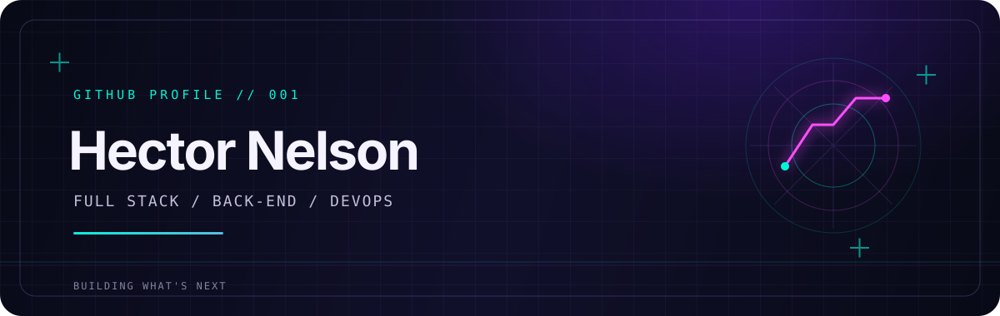

### `FULL STACK` · `BACK-END` · `DEVOPS`

Construindo aplicações, integrações e automações — sempre aprendendo e explorando novas ideias.

---

## `> SOBRE_MIM` 🧑‍💻

Sou **Hector Nelson**. Trabalho em projetos de desenvolvimento **full stack** e **back-end**, e tenho interesse em **DevOps**, automação e sistemas conectados. Gosto de transformar ideias em soluções práticas — de aplicações web e mobile a integrações e ferramentas para o dia a dia.

## `> STACK` ⚡

Tecnologias identificadas nos meus repositórios públicos:

**Linguagens**  

**Frameworks, plataformas e ferramentas**  

## `> DASHBOARD` 📡

## `> PROJETOS_EM_DESTAQUE` 🧩

- 🏐 **[Volleyball](https://github.com/hectornetf/Volleyball)** — gestão para grupos de vôlei com React, Vite, React Native, Expo e Firebase.
- 🔌 **[ngx-sails-io](https://github.com/hectornetf/ngx-sails-io)** — integração de Angular com Sails.js e Socket.IO.
- 🖥️ **[WebAppCrudEF2](https://github.com/hectornetf/WebAppCrudEF2)** — aplicação CRUD com ASP.NET MVC e Entity Framework Core.
- ⚙️ **[MonitoramentoDisco](https://github.com/hectornetf/MonitoramentoDisco)** — automação PowerShell para relatórios de espaço em disco.
- 🐍 **[Snake](snake.html)** — jogo da cobrinha para uma pausa entre projetos.

## `> CONECTAR` 🌐

Veja meus [repositórios](https://github.com/hectornetf?tab=repositories) e acompanhe os projetos por aqui. Para contato profissional, envie uma mensagem pelo GitHub.

---

`SYSTEM STATUS: LEARNING • BUILDING • SHIPPING`

*Valeu pela visita. Até a próxima!* ✨

